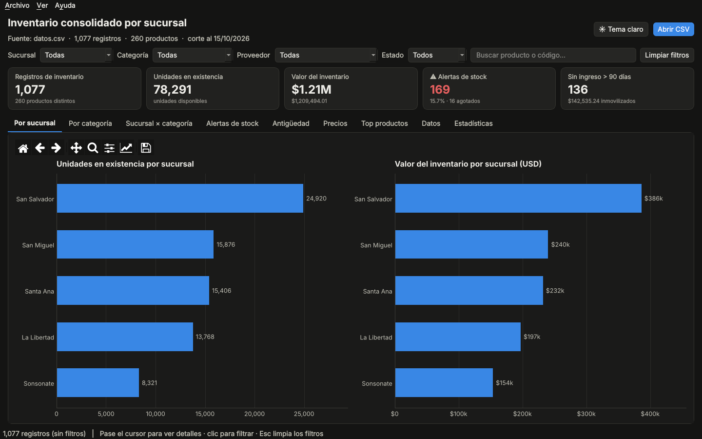
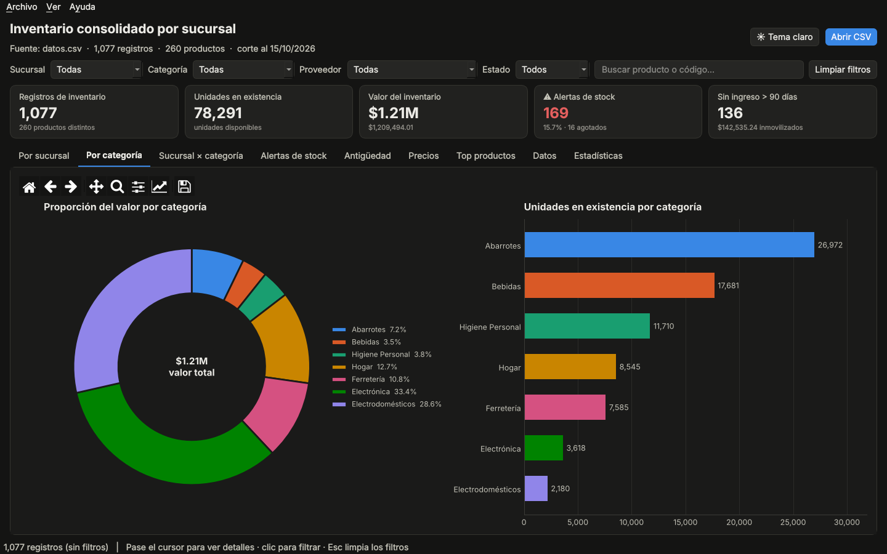
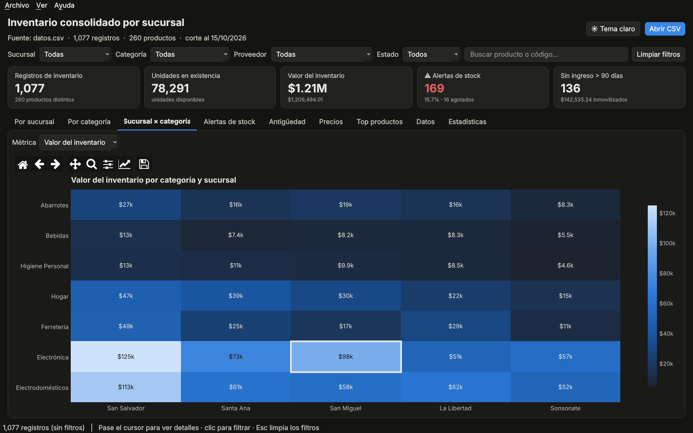
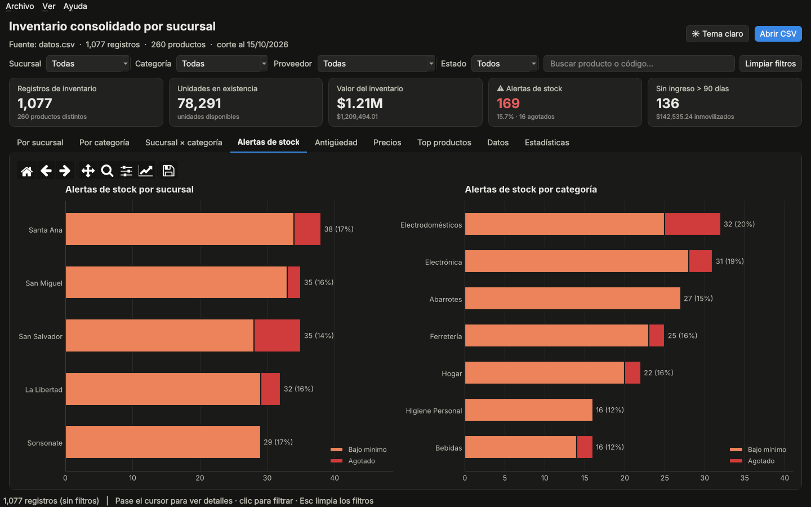
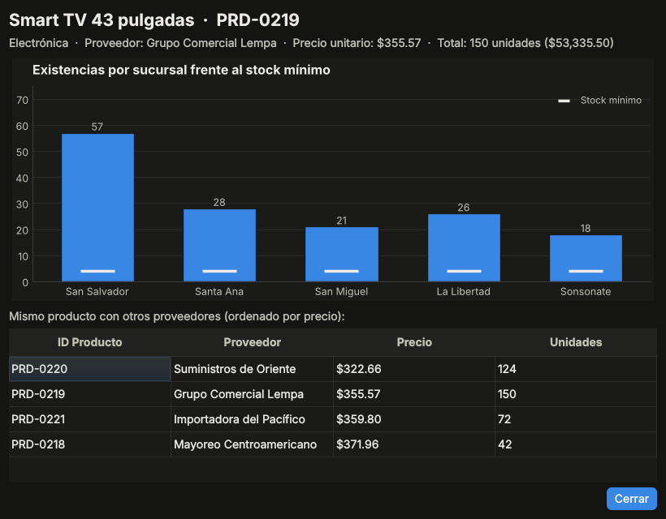
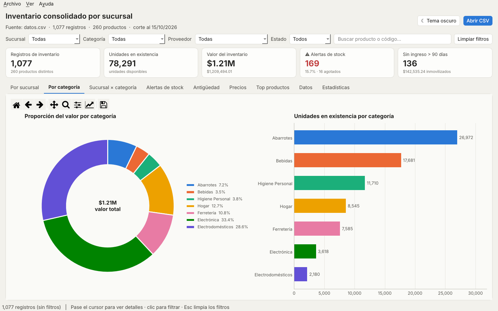
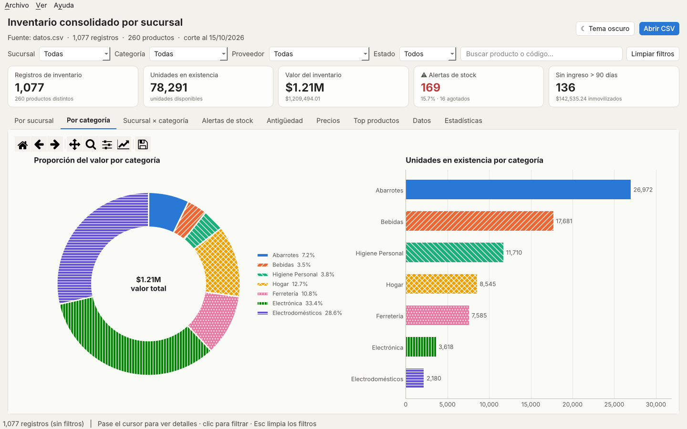

# InventarioSV — Visor de Inventario por Sucursal

**Universidad Gerardo Barrios** · Facultad de Ciencias y Tecnología
**Asignatura:** Programación Computacional III · Parcial — Segundo Cómputo

## Integrantes

| Nombre | Carnet |
|---|---|
| Abraham Bladimir Umanzor Vásquez | SMSS201426 |
| _Nombre del segundo integrante_ | _Carnet_ |

## Descripción

Solución de consultoría de datos para una empresa salvadoreña que comercializa productos en cinco sucursales: **San Salvador, Santa Ana, San Miguel, La Libertad y Sonsonate**.

El proyecto se divide en tres partes:

1. **Inventario (`datos.csv`)**: conjunto de datos de 1,077 registros generado con Pandas y NumPy, que representa las existencias de 260 productos (SKU) en siete categorías y cinco proveedores.
2. **Análisis exploratorio (`generar_datos.py`)**: inspección de la estructura, tipos de datos, calidad y estadísticas descriptivas del inventario con funciones de Pandas.
3. **Aplicación gráfica (`codigo_fuente.py`)**: interfaz de escritorio interactiva en PyQt5 que integra gráficos de Matplotlib, con información al pasar el cursor, filtros por clic, búsqueda, detalle de producto y temas cómodos para la vista.

Los hallazgos, conclusiones y recomendaciones se presentan en `informe_consultoria.pdf`.

## Estructura del repositorio

```
├── generar_datos.py           Generación del inventario y análisis con Pandas
├── codigo_fuente.py           Aplicación gráfica PyQt5 + Matplotlib
├── datos.csv                  Inventario generado (1,077 registros)
├── informe_consultoria.pdf    Informe de consultoría
├── capturas/                  Capturas de la aplicación
├── requirements.txt           Dependencias del proyecto
├── .gitignore
└── readme.md
```

## Diccionario de datos

| Columna | Tipo | Descripción |
|---|---|---|
| `ID_Producto` | texto | Código único del producto (SKU), formato `PRD-0000` |
| `Producto` | texto | Nombre y presentación del producto |
| `Categoria` | texto | Abarrotes, Bebidas, Higiene Personal, Hogar, Ferretería, Electrónica, Electrodomésticos |
| `Sucursal` | texto | Sucursal donde se encuentra la existencia |
| `Proveedor` | texto | Proveedor que abastece el producto |
| `Cantidad` | entero | Unidades disponibles en la sucursal |
| `Precio_Unitario` | decimal | Precio de venta por unidad en USD |
| `Stock_Minimo` | entero | Nivel mínimo de existencias antes de reabastecer |
| `Fecha_Ultimo_Ingreso` | fecha | Último ingreso de mercadería a la sucursal |

Durante el análisis se calculan además `Valor_Inventario` (Cantidad × Precio_Unitario), `Dias_Sin_Ingreso` y `Estado_Stock` (Normal, Bajo mínimo, Agotado).

## Requisitos

- Python 3.10 o superior
- Dependencias listadas en `requirements.txt`

## Instalación y ejecución

1. Clonar el repositorio:

   ```bash
   git clone https://github.com/Chester21U/InventarioSV.git
   cd InventarioSV
   ```

2. Crear y activar un entorno virtual:

   ```bash
   python -m venv venv
   venv\Scripts\activate        # Windows
   source venv/bin/activate     # Linux / macOS
   ```

3. Instalar dependencias:

   ```bash
   pip install -r requirements.txt
   ```

4. (Opcional) Regenerar el inventario y ver el análisis en consola. Usa una semilla fija, por lo que siempre produce el mismo `datos.csv`:

   ```bash
   python generar_datos.py
   ```

5. Ejecutar la aplicación gráfica:

   ```bash
   python codigo_fuente.py
   ```

## Funcionalidades de la aplicación

### Interactividad

- **Información al pasar el cursor**: cada barra, porción, celda y caja muestra su valor exacto, porcentaje y detalle.
- **Clic para filtrar**: un clic en una sucursal, categoría o celda del mapa de calor filtra toda la aplicación; un segundo clic quita el filtro.
- **Filtros combinados**: sucursal, categoría, proveedor, estado de stock (normal, con alerta, bajo mínimo, agotado) y búsqueda por nombre o código.
- **Tarjetas de indicadores clicables**: registros, unidades, valor, alertas de stock y productos sin ingreso reciente.
- **Detalle de producto**: doble clic en la tabla o clic en *Top productos* abre una ventana con las existencias por sucursal frente al stock mínimo y la comparación de precios entre proveedores.
- **Controles por gráfico**: métrica del mapa de calor, umbral de días sin movimiento, escala logarítmica de precios y tamaño del ranking.
- Zoom, desplazamiento y exportación de cada gráfico a PNG, PDF o SVG.
- Exportación de los datos filtrados a CSV.

### Comodidad visual y accesibilidad

- **Tema oscuro y tema claro** (`Ctrl+T`), con fondos suaves sin blanco ni negro puros para reducir la fatiga visual.
- **Paleta segura para daltonismo**: los colores de las categorías fueron validados para protanopia, deuteranopia y tritanopia.
- **Patrones de relleno** opcionales (`Ctrl+P`) para distinguir categorías sin depender del color.
- **Tamaño de texto ajustable** (`Ctrl +`, `Ctrl -`, `Ctrl 0`).
- Las preferencias de tema, patrones, tamaño y ventana se recuerdan entre sesiones.

### Gráficos

| Pestaña | Contenido |
|---|---|
| Por sucursal | Unidades y valor del inventario por sucursal |
| Por categoría | Proporción del valor (dona) y unidades por categoría |
| Sucursal × categoría | Mapa de calor con cuatro métricas seleccionables |
| Alertas de stock | Productos bajo mínimo y agotados por sucursal y categoría |
| Antigüedad | Días desde el último ingreso, con umbral ajustable |
| Precios | Distribución de precios por categoría (diagrama de caja) |
| Top productos | Ranking por valor o unidades |
| Datos | Tabla ordenable con el inventario filtrado |
| Estadísticas | Resumen de `info()`, `describe()`, correlación y frecuencias |

### Atajos de teclado

| Atajo | Acción |
|---|---|
| `Ctrl+O` | Abrir CSV |
| `Ctrl+E` | Exportar datos filtrados |
| `Ctrl+S` | Guardar gráfico actual |
| `Ctrl+T` | Cambiar tema |
| `Ctrl+P` | Patrones de relleno |
| `Esc` | Limpiar filtros |
| `F1` | Ayuda |

### Manejo de errores

La aplicación valida que el archivo exista, tenga formato CSV en UTF-8, contenga las columnas obligatorias, no tenga valores vacíos y que cada columna tenga el tipo de dato correcto, mostrando un mensaje claro en cada caso.

## Capturas

**Inventario por sucursal**


**Composición por categoría**


**Mapa de calor (la celda bajo el cursor se resalta)**


**Alertas de stock**


**Detalle de producto**


**Tema claro y patrones para daltonismo**



## Tecnologías

Python · Pandas · NumPy · PyQt5 · Matplotlib
